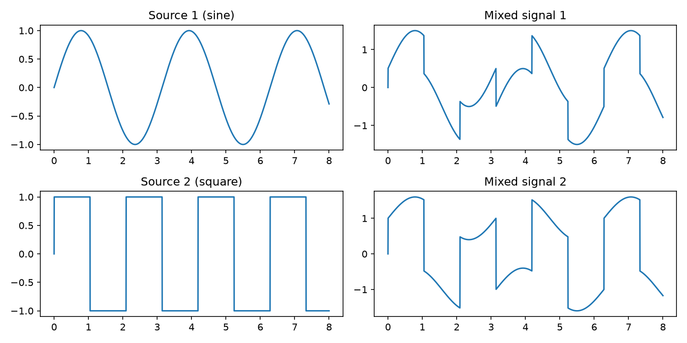
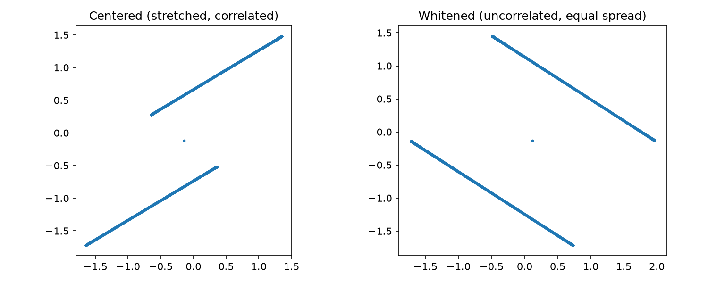
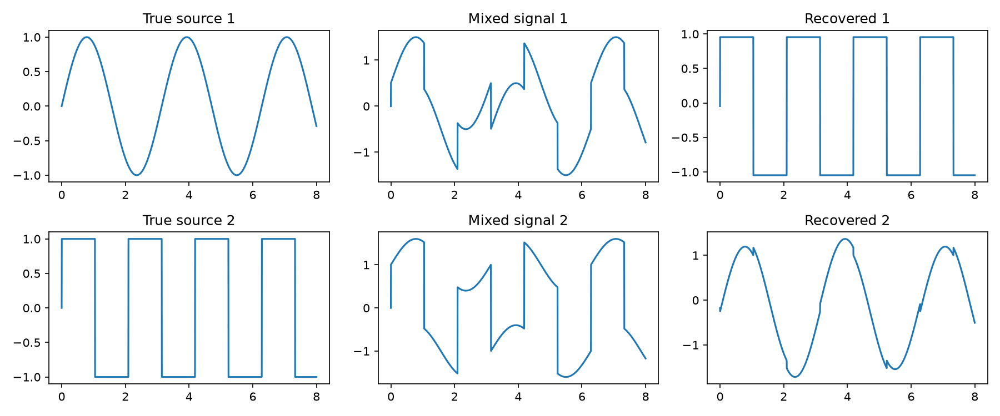

## Step 1: Mixing

Two source signals (a sine wave and a square wave) are mixed with a matrix A,
so each "microphone" recording contains a bit of both sources.
The goal of ICA is to recover the original sources from the mixtures alone.

X = A @ S

## Step 2: Whitening

Whitening makes the mixed signals uncorrelated with equal variance.
After whitening, the covariance matrix is the identity matrix.

## Step 3: FastICA

After whitening, only a rotation is left to find. FastICA searches for the
rotation that makes the outputs as non-Gaussian as possible.

Correlation between true sources (rows) and recovered signals (columns):

|                    | Recovered 1 | Recovered 2 |
|--------------------|-------------|-------------|
| True source 1 (sine)   | 0.086   | 0.996       |
| True source 2 (square) | 1.000   | ~0          |

Each true source matches exactly one recovered signal. The order is swapped,
which is the permutation ambiguity of ICA.

## Step 4: Audio ICA demo

`audio_utils.py` loads and saves audio files. `ica.py` provides the centering, whitening, FastICA, and source-matching functions. `run_ica.py` loads audio from `sources/`, mixes and separates the signals, then saves the audio results in `audio/` and the comparison plot in `images/results.png`.

**Live demo:** [ICA Project on Render](https://ica-project.onrender.com)

## Step 5: Mini song matcher

The matcher compares a short audio clip with songs in `library/` and finds the closest match. You can also use an ICA-separated WAV file as the clip.

## Step 6: Random mixing and matching

Two songs are randomly selected from `library/` and mixed. The mixtures are whitened and separated with FastICA, then each output is matched to its source song.

**Song mixing demo:** [View the random mixing and ICA matching demo](https://ica-project.onrender.com/song_demo.html)
